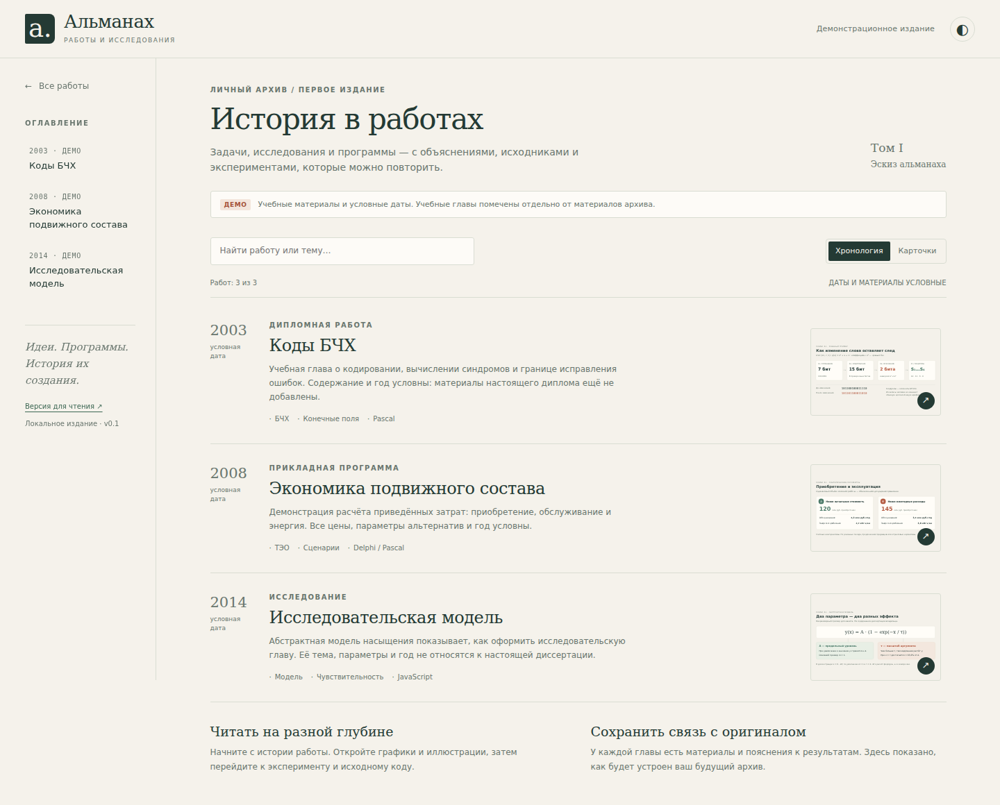
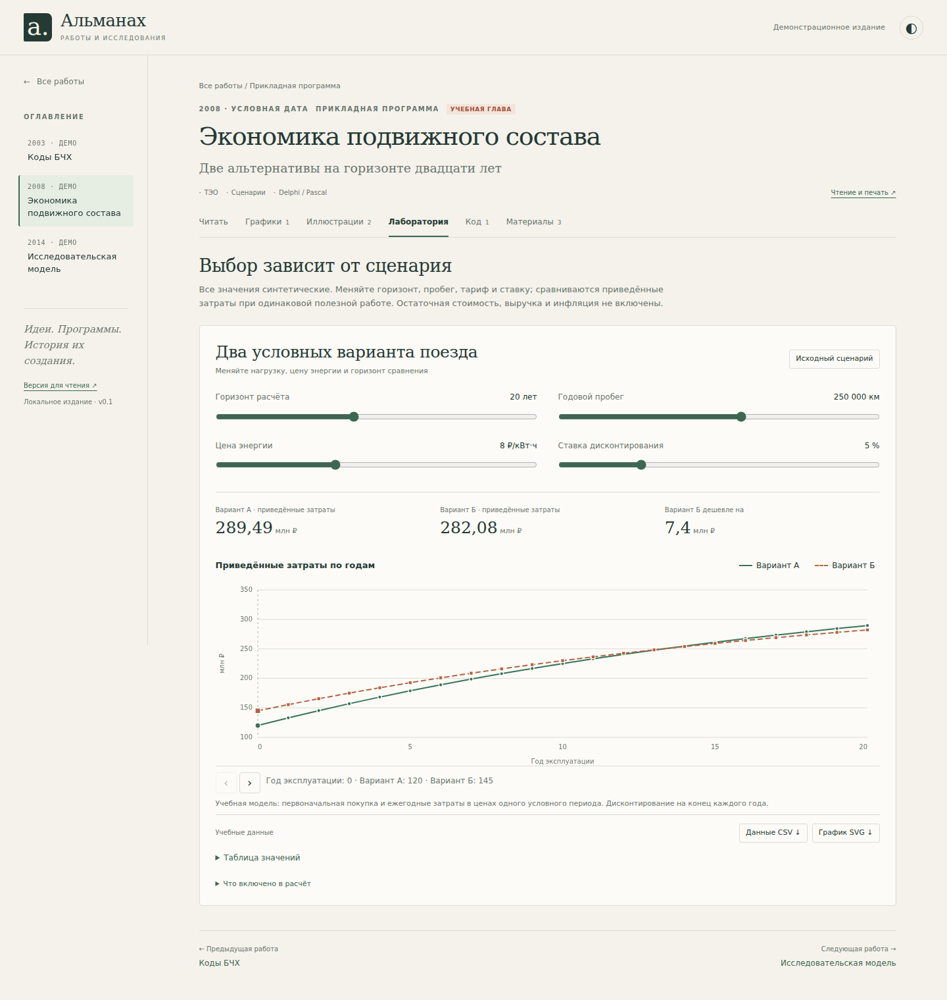

# Альманах работ

Личная биография через исследования, инженерные задачи и программы. Каждая работа
становится главой: её можно прочитать, рассмотреть иллюстрации, изучить код и повторить
подготовленный эксперимент в браузере.

**Сейчас это работающий макет с demo-данными для совместной доработки интерфейса.**
Реальный диплом, диссертация и архив программ ещё не импортированы. Названия тем
показывают предполагаемые направления, а годы, тексты, рисунки и коэффициенты условны.



## Открыть и посмотреть

1. [Скачайте ZIP репозитория](https://github.com/i12309/Almanac/archive/refs/heads/main.zip).
2. Распакуйте **всю папку**, сохранив её внутреннюю структуру.
3. Откройте `index.html` обычным браузером.

Интернет, сервер, установка пакетов и сборка для просмотра не нужны. Открытие отдельного
`index.html` прямо внутри ZIP или его перенос без папок `assets` и `content` не является
поддерживаемым способом запуска. Проверенный браузер и границы проверки указаны в
[отчёте](docs/VERIFICATION.md).

Для чтения без JavaScript откройте `read/index.html`. Там сохранены полные главы,
рисунки, таблицы, исходники и ссылки на материалы. Эти страницы также удобны для печати.

**GitHub Pages пока не включён.** Решение о публикации принимается после обсуждения
макета; [план следующего этапа](docs/PAGES_PLAN.md) подготовлен отдельно.

## Что попробовать в макете

| Часть | Что уже работает |
| --- | --- |
| Оглавление | Хронология или карточки, поиск по названию, теме и описанию |
| Глава | Последовательное чтение, оглавление разделов, предыдущая и следующая работа |
| Графики | Несколько рядов, точные значения, включение и скрытие серий, управление клавиатурой, таблица, экспорт CSV и SVG |
| Иллюстрации | Галерея, увеличение, перемещение увеличенного изображения, перелистывание, скачивание |
| Программы | Подсветка Pascal и JavaScript, номера строк, выделение объясняемых фрагментов, копирование и скачивание |
| Лаборатория | Подготовленные вычисления с изменяемыми параметрами и возвратом исходного сценария |
| Оформление | Светлая и тёмная темы, узкий экран, навигация с клавиатуры |
| Материалы | Подписи, происхождение и скачиваемые файлы, заметки о допущениях |

### Три демонстрационные главы

- **Коды БЧХ.** Учебный BCH(15,7,5): кодирование семи бит, изменение принятого слова,
  расчёт четырёх синдромов. Есть сценарий двух ошибок и пример пяти изменений,
  переводящих слово в другое допустимое. Это демонстрация синдромов; декодер и
  исправление ошибок здесь не реализованы.
- **Экономика подвижного состава.** Две условные альтернативы, изменение горизонта,
  годового пробега, цены энергии и ставки дисконтирования. График и итоговые
  приведённые затраты пересчитываются вместе. Финансовые параметры учебные.
- **Исследовательская модель.** Абстрактная функция насыщения с двумя параметрами.
  Она показывает механику будущей исследовательской главы и не описывает тему
  реальной диссертации.

Подробные формулы, соглашения, ограничения и контрольные значения находятся в
[описании экспериментов](docs/EXPERIMENTS.md). Pascal-файлы написаны для демонстрации
просмотра исходников; браузер выполняет отдельно подготовленные функции JavaScript.



## Как устроен репозиторий

| Путь | Назначение |
| --- | --- |
| `index.html` | Готовая точка входа для читателя |
| `assets/css/site.css` | Оформление и адаптация к размеру экрана |
| `assets/js/app.js` | Навигация, просмотр материалов и управление экспериментами |
| `assets/js/chart.js` | Графики SVG, выбор значений и экспорт |
| `assets/js/labs.js` | Проверяемые вычислительные ядра |
| `content/works/*.json` | Редактируемое содержание глав |
| `content/assets/<id>/` | Рисунки, CSV, код и выбранные публичные материалы работы |
| `content/schema/work.schema.json` | Описание структуры главы |
| `assets/js/content.generated.js` | Сгенерированные данные для локального открытия |
| `read/` | Сгенерированное полное издание для чтения без JavaScript |
| `templates/` | Шаблон главы, досье источников и отчёт об импорте |
| `tools/`, `tests/` | Сборка содержания и проверки разработчика |
| `docs/` | Замысел, правила переноса архива, ТЗ и результаты проверок |

Исходное содержание отделено от интерфейса. Сборщик заранее упаковывает данные
в обычный локальный JavaScript-файл, поэтому просмотр не зависит от загрузки JSON
через `fetch`, сервера или менеджера пакетов. Все ресурсы сайта находятся в папке
репозитория, навигация использует адреса с `#`.

## Дальнейшая работа

1. Посмотреть макет и согласовать чтение, навигацию, графики, галерею, код и эксперименты.
2. Доработать интерфейс по конкретным замечаниям; ориентир —
   [лист обсуждения макета](docs/DESIGN_REVIEW.md).
3. Отдельно выбрать и настроить публикацию Pages.
4. Передать агенту архив одной работы и согласованный репозиторий.
5. Выполнить пилотный перенос по [ТЗ](docs/CODEX_SPEC.md), проверить смысл и числа,
   затем использовать этот опыт для остальных работ.

В [CODEX_START.md](CODEX_START.md) подготовлено задание, которое можно дать агенту
вместе с репозиторием. [AGENTS.md](AGENTS.md) содержит постоянные инструкции.

### Документация

- [Замысел альманаха](docs/CONCEPT.md) — для кого и как устроено издание.
- [Подготовка содержания](docs/CONTENT_GUIDE.md) — как разбирать Word, Pascal и Delphi,
  сохранять оригиналы, устанавливать источники и заполнять главу.
- [ТЗ для Codex](docs/CODEX_SPEC.md) — этапы работ, обязательные требования и приёмка.
- [Вычисления и ограничения](docs/EXPERIMENTS.md) — что делают текущие учебные примеры.
- [Проверки](docs/VERIFICATION.md) — фактически выполненная проверка этой версии.

## Для разработчика

Готовые файлы уже включены в репозиторий. Следующие действия нужны **после изменения
содержания или программы**, а не читателю альманаха.

Сборка использует только стандартную библиотеку Python 3:

```sh
python3 tools/build.py --validate
python3 tools/build.py
python3 tools/build.py --check
```

На Windows вместо `python3` может использоваться `py -3`. Не редактируйте
`content.generated.js` и `read/*.html` вручную: измените JSON или соответствующий
исходник и повторите сборку. Для новой главы начните с `templates/work.json.example`.

Проверки вычислений и данных используют встроенный тестовый модуль Node.js:

```sh
node --test tests/*.test.cjs
```

Проверка браузера требует отдельных зависимостей разработчика:

```sh
npm install
npx playwright install chromium
npm run test:browser
```

При необходимости укажите путь к уже установленному Chromium переменной
`ALMANAC_CHROMIUM_EXECUTABLE`. Проверка создаёт временные результаты в игнорируемой
папке `artifacts/`, проверяет `file://` без сети и сама поднимает локальный HTTP-сервер
для проверки пути `/Almanac/`.

## Работа с настоящим архивом

Неподготовленный архив хранится вне публичной части проекта. Для локальной работы
предусмотрены игнорируемые папки `inbox/` и `archive-private/`. В `content/assets/`
попадают только выбранные материалы, предназначенные для публикации. Статус главы
`draft` описывает её редакционную готовность и не скрывает её от читателя.

Оригинал, извлечённое представление, реконструкция и учебный пример должны оставаться
различимыми. Неизвестные даты и утраченные результаты не заполняются догадками.
